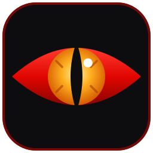

  

<h1 align="center">efpies</h1>

<b>Oyunlarından en yüksek FPS'i almanı sağlayan, her şeyi senin iznine bırakan Windows uygulaması.</b>

  <a href="https://github.com/oqqy-dev/efpies/releases/latest"><b>⬇ En son sürümü indir</b></a>

---

## efpies nedir?

Bir oyun kurduğunda doğru ayarları bulmak için videolar izler, forumları gezer, hangi kodun işe yaradığını tahmin etmeye çalışırsın. **efpies bunu senin yerine yapar.**

Bilgisayarını tanır, kurduğun oyunları bulur ve her oyun için en iyi ayarları **tek tek, nedenleriyle** gösterir. Sen hangilerini istediğini işaretlersin, efpies uygular. Sonra oyunu oynadığında FPS'in **önce ne kadardı, sonra ne kadar oldu** diye rapor verir.

Hiçbir şeyi sormadan değiştirmez. Yaptığı her şeyi tek tıkla geri alabilirsin.

---

## Neler yapabilir?

### 🎮 Oyunlarını kendisi bulur
- **Steam** ve **Epic Games** kütüphanelerini tarar, kurulu oyunlarını listeler.
- Yeni bir oyun kurduğunda bildirim gönderir: *"Yeni oyun bulundu, en iyi ayarlar hazır."*

### 🖥️ Bilgisayarını tanır
- Ekran kartını, işlemcini, belleğini ve monitörünün yenileme hızını (Hz) okur.
- Önerilerini **senin donanımına göre** yapar. Giriş seviyesi bir ekran kartıyla üst seviye bir kartın önerileri aynı olmaz.

### ⚙️ Her oyun için en iyi ayarları gösterir
- Her ayarın yanında **şu anki değeri**, **önerilen değeri**, **ne işe yaradığı** ve **etkisinin ne kadar olduğu** (yüksek / orta / düşük) yazar.
- İki mod vardır:
  - **Rekabetçi:** FPS'i yüksek tutarken rakipleri daha net görmeni sağlar (örneğin düşman gölgeleri açık kalır).
  - **Maksimum FPS:** Her şeyi en yüksek kare hızı için ayarlar.
- Hiçbir şey otomatik uygulanmaz: istediklerini işaretleyip **"Seçilenleri uygula"**ya basarsın.

### 🧾 CS2 başlatma kodlarını açıklar
- İnternette dolaşan onlarca "FPS artıran kod"u araştırıp etiketledik: **Çalışıyor**, **Tartışmalı**, **Etkisiz**, **Zararlı**.
- Steam'de işe yaramayan veya zarar veren eski kodlar varsa (örneğin VAC korumasını kapatan `-insecure` ya da performansı bozabilen `-threads`) bunları bulur ve kaldırmayı önerir.
- Her kodun yanında **Kopyala** düğmesi vardır.

### 🟩 NVIDIA ayarlarını yapar
- NVIDIA Denetim Masası'ndaki ayarları (güç yönetimi, V-Sync, düşük gecikme, doku filtreleme) **sadece o oyun için** ayarlar.
- Masaüstünde ve diğer programlarda hiçbir şey değişmez; dizüstü bilgisayarlarda pil boşuna tükenmez.

### 🪟 Windows'u oyuna hazırlar
- Güç planı, Oyun Modu, arka planda video kaydeden Xbox Game Bar gibi FPS'i etkileyen Windows ayarlarını kontrol eder.
- Monitörün düşük Hz'de çalışıyorsa veya bellek tek kanaldaysa sana söyler.

### 📊 FPS'i ölçer ve rapor verir
- Oyun açıldığında FPS'i arka planda ölçer. Bilgisayarı yormaz; sadece özet bilgi saklar.
- Her ayar değişikliğinden, sürücü güncellemesinden veya Windows güncellemesinden sonra şöyle bir rapor çıkarır:
  > **Counter-Strike 2:** FPS arttı: 142 → 156 (+%9,9) · En düşük anlardaki FPS: 84 → 95
- Böylece bir değişikliğin gerçekten işe yarayıp yaramadığını tahminle değil, **ölçerek** görürsün.

### 🔄 NVIDIA sürücülerini günceller
- Her açılışta yeni NVIDIA sürücüsü var mı diye bakar.
- Varsa **ne içerdiğini sade Türkçe ile** anlatır: hangi oyunlar için hazırlandığı, kaç hata düzelttiği, senin oyunların için bir iyileştirme içerip içermediği.
- Sana sorar: **Şimdi kur / Oyun kapanınca kur / Bu sürümü atla.** Oyun oynarken asla kurmaz.
- Kurulumdan sonra yeni sürücünün FPS'ine katkısını raporlar.

### 🛡️ Windows güncellemelerini yönetir
- Bekleyen her güncellemenin **ne olduğunu ve FPS'e etkisini** anlaşılır şekilde yazar (örneğin "Virüs tanımları — FPS'e etkisi yok").
- Riskli olanları (deneme sürümleri, Windows'un getirdiği eski NVIDIA sürücüsü) **asla kendiliğinden kurmaz**.
- İstersen güncellemeleri oyun kapanınca kurar.

### 🌡️ Canlı panel
- Ekran kartı ve işlemci **sıcaklığı**, kullanım oranları, bellek ve oyun sırasında **canlı FPS** tek ekranda.
- Sıcaklık yükselirse "Ilık" veya "Sıcak" diye uyarır.

### 🧩 Oyun güncellenince ayarlarını korur
- Oyunlar güncellendiğinde bazen ayarları sıfırlar. efpies güncellemeyi fark eder, ayarları yeniden kontrol eder ve **senin daha önce onayladığın** ayarları geri düzeltir.
- Oyun açıksa beklemeye alır, oyun kapanınca düzeltir.

### ↩️ Her şey geri alınabilir
- efpies bir ayarı ilk kez değiştirmeden önce **orijinal değerini kalıcı olarak saklar**.
- **"Eskiye dön"** ekranından tek bir değişikliği, bir oyunun tüm ayarlarını ya da her şeyi ilk haline döndürebilirsin.
- Geri alma da kaydedilir; yanlışlıkla geri aldıysan onu da geri alabilirsin.

### 🚀 Kendini güncel tutar
- efpies'in yeni sürümleri arka planda iner ve oyun bittikten sonra ya da efpies kapanırken kurulur.

---

## Hangi oyunları destekler?

| Oyun | Neler ayarlanır |
|---|---|
| **Counter-Strike 2** | Grafik ayarları, konsol komutları, Steam başlatma kodları, NVIDIA |
| **Fortnite, PUBG, Marvel Rivals, THE FINALS** | Grafik ayarları, NVIDIA |
| **Apex Legends** | Başlatma kodları, grafik ayarları, NVIDIA |
| **Rainbow Six Siege, Overwatch 2, Rocket League** | Grafik ayarları, NVIDIA |
| **Dota 2, Team Fortress 2, Rust** | Başlatma kodları, NVIDIA |
| **Unreal Engine ile yapılmış diğer oyunlar** | Otomatik tanınır, grafik ayarları önerilir |
| **Diğer tüm oyunlar** | Donanımına göre genel öneriler ve Windows ayarları |

---

## Güvenli mi?

- **Sormadan hiçbir şey değiştirmez.** Her ayarı sen seçersin.
- **Her şey yedeklenir** ve tek tıkla geri alınabilir.
- **Oyun dosyalarına müdahale etmez.** Sadece oyunların kendi ayar dosyalarını ve Steam başlatma seçeneklerini değiştirir; oyunun içine kod eklemez. Hile koruma sistemlerini (VAC vb.) tetikleyecek hiçbir şey yapmaz.
- Yönetici izni gereken işlemlerden (sürücü kurulumu gibi) önce **ne olacağını açıkça anlatır** ve iznini ister.

---

## Kurulum

1. [**Releases**](https://github.com/oqqy-dev/efpies/releases/latest) sayfasından `efpies-Kurulum-<sürüm>.exe` dosyasını indir.
2. Çift tıklayıp kur. Windows *"Bilinmeyen yayımcı"* uyarısı gösterirse **Ek bilgi → Yine de çalıştır**'a bas (uygulama henüz dijital olarak imzalanmadı).
3. Masaüstündeki **efpies** simgesinden aç.

**Gereksinimler:** Windows 11 veya Windows 10 (64 bit). NVIDIA ayarları ve sürücü güncellemeleri için NVIDIA ekran kartı.

---

## Sık sorulan sorular

**FPS'im ne kadar artar?**
Bilgisayarına ve oyuna göre değişir. efpies bunu tahmin etmez, **ölçer**: değişiklikten önceki ve sonraki oyunlarını karşılaştırıp gerçek farkı gösterir.

**Arka planda çalışırken bilgisayarımı yavaşlatır mı?**
Hayır. Sıcaklık ve FPS sadece panel açıkken veya oyun oynarken ölçülür; geri kalan zamanda sadece birkaç saatte bir güncelleme kontrolü yapar.

**Beğenmezsem ne olur?**
"Eskiye dön" ekranından her şeyi tek tıkla orijinal haline döndürebilirsin. Uygulamayı kaldırsan bile yedeklerin silinmez.

---

Geliştiriciler için teknik notlar: [docs/GELISTIRME.md](docs/GELISTIRME.md)
